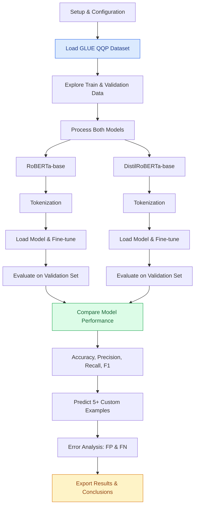

# aiml_nlp_qqp_roberta

Fine-tuning and comparative evaluation of **RoBERTa** and **DistilRoBERTa** for duplicate question detection using the **GLUE QQP dataset**.

## Overview

**QQP (Quora Question Pairs)** → A dataset of labelled question pairs originally released by Quora and included in the **GLUE (General Language Understanding Evaluation)** benchmark.

The task is **binary sequence-pair classification**: given two questions, predict whether they have the same meaning (duplicate) or not.

## Models

Two pretrained Transformer models are fine-tuned and compared:

- **`roberta-base`** → A larger model with greater capacity for understanding language.
- **`distilroberta-base`** → A smaller, distilled version designed to be faster and computationally more efficient.

Both models are fine-tuned rather than trained from scratch, adapting their existing language representations to duplicate question detection.

## Objective

To investigate, compare the models using **Accuracy, Precision, Recall and F1-Score**.

**Does the larger RoBERTa model justify its additional computational cost, or can DistilRoBERTa achieve comparable performance with fewer resources?**

## Technology

Python · Jupyter Notebook · Hugging Face Transformers · Hugging Face Datasets · PyTorch

---

